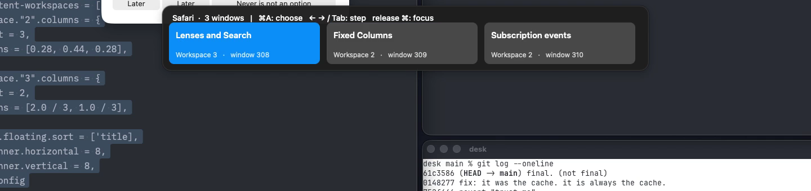

# A window row above the system's Cmd-Tab

The row orders **1.692 ms behind the first readable system highlight at the median** (0.785–11.291 ms, twelve openings). Five frame-timestamped openings show it **0, 1, 0, 0 and 1 frames behind the visible switcher**. A single Safari process still flashes its shown-workspace window before the hidden-workspace choice when release is left to the Dock. Leaving the switcher with Command-Escape on Cmd-A removes that intermediate switch in the measured alternative. **Build it with that handoff.**

This is a standalone guest prototype. It changes no shipped WinMux behavior, adds no test or setting, and copies no DockDoor source or asset. The proposed feature remains off by default. Its draft is [A window row above the system switcher](../../build/114-a-window-row-above-the-system-switcher.md).

## Setup and evidence boundary

The guest ran macOS 26.6.2 at 1920 × 1080, using the pinned Swift 6.4 toolchain. Both host and guest `make check` passed before the live run: 1,506 Swift tests and 171 script tests, with one existing guest-only script skip for its synthetic sync commit; helper checks also passed. The first pass separately built base/head trees and compared their native-switcher behavior and fourteen-window inventory. That comparison was not repeated in the follow-up; its changes remain entirely under `.scratch/`.

The rich desk was restaged, then `prepare.sh` installed the literal config without Cmd-Tab, Cmd-Shift-Tab or Cmd-backtick takeover bindings. Doctor reported no held symbolic hotkeys. A cliclick Command hold displayed the native switcher with WinMux running. No permission was granted. The driver-provided guest and disk were retained.

The follow-up inventory maps Zed 282, Ghostty 292/pid 11718 and 300/pid 11733, Notes 318, Safari 308/309/310 (all pid 11746), TextEdit 328/329/330, Finder 335, Preview 343, Calculator 348 and Updater 367. Safari 308, “Lenses and Search,” moved from workspace 2 to 3; 309, “Fixed Columns,” and 310, “Subscription events,” stayed on 2. These are fixture ids, not reusable discovery logic.

External evidence is indexed in `captures/index.md`, under `row2/`. The accepted timing log is `measure.jsonl`; the hero logs/movies are `hero.*` and `detach-hero.*`. Earlier first-pass evidence remains under `captures/row/`. No Search is used by these drivers.

macOS 27, an installed build, a real keyboard, multiple displays and real sleep/wake/unlock were not run. These remain acceptance work, not reasons to infer failure.

## The Dock element

An independent AX tree walk found:

```text
AXApplication title=Dock
  AXList subrole=AXProcessSwitcherList frame=(269,452,1382,176)
    AXButton title=Zed
    AXButton title=Safari
    AXButton title=TextEdit
    AXButton title=Notes
    AXButton title=Ghostty
    AXButton title=Ghostty
    ...
```

The list's `AXSelectedChildren` supplies the highlighted button. The list supplies its AX frame. Its buttons expose title, role, focus and geometry; they expose **no AXURL or application pid** in this run. `button-attributes.txt` contains the full attribute-name enumeration, including the failed AXURL reads. Ordinary Dock items have AXURL, but their two Ghostty URLs are identical.

The Dock application accepts `AXCreated`, `AXSelectedChildrenChanged` and `AXUIElementDestroyed`. The list accepts the last two. Registrations retry independently until all required registrations succeed; an observer existing does not imply successful selection/destruction subscriptions. The 5 ms fallback discovers an armed opening and polls while either list subscription is missing. Once both work, notifications track highlights and disappearance; release has an independent modifier-state check. A bare Command hold never starts discovery. Under Secure Input, the list's AXCreated can arm discovery, but policy suppresses the row and snapshot.

Running-application and finished-launching observations reattach after a Dock restart. The follow-up recovered in 313.668 ms idle and 137.432 ms during a hold, from observed exit to registration. The held session closed without focusing and the next gesture showed a row. These are observation intervals, not a guarantee of the earliest retry.

## Per-process rows

A unique button title matched a cached `NSRunningApplication.localizedName` to a pid for Safari and the other uniquely named applications. Windows are then filtered **only by that pid**. AXURL matching is implemented but did not work on these switcher buttons.

For duplicate names/URLs the prototype records application activations and associates the duplicate buttons' order with the observed process recency order. It shows no row until every matching process has been observed. This is a measured prototype association, not a public pid attribute or a general guarantee about Dock ordering. A feature must validate that association across its supported systems and suppress an unresolved icon rather than combine processes.

`identity.jsonl`, `ghost1.mov` and `ghost2.mov` verify the seeded fixture in both directions: the first icon showed only 292/pid 11718 and native release selected that pid; the second showed only 300/pid 11733 and native release selected that pid. Both readbacks agree. The first pass's combined Ghostty row was wrong: it offered a window belonging to the other icon's process.

## Timing relative to the system

The snapshot starts on the opening Cmd-Tab key-down observed by the event tap. Its start stamp is immediately before launching the CLI, rather than after the first AX read. Process setup accounts for a measured 13.808–17.731 ms before that launch stamp; the snapshot still finishes well before the Dock is readable. One snapshot is used for the entire session, including later Tab and Shift-Tab changes.

The accepted twelve openings, in milliseconds from the opening event's CGEvent timestamp:

| Opening | AXCreated callback | First read | Row ordered | Row − read |
| --- | ---: | ---: | ---: | ---: |
| 1 | 176.664 | 173.573 | 176.492 | 2.919 |
| 2 | 179.534 | 175.985 | 176.931 | 0.947 |
| 3 | 174.840 | 172.293 | 173.796 | 1.503 |
| 4 | 179.279 | 173.246 | 175.177 | 1.931 |
| 5 | 183.256 | 176.324 | 178.207 | 1.882 |
| 6 | 177.966 | 174.790 | 175.574 | 0.785 |
| 7 | 181.133 | 177.435 | 178.576 | 1.141 |
| 8 | 175.462 | 173.616 | 175.032 | 1.416 |
| 9 | 182.724 | 176.506 | 178.473 | 1.967 |
| 10 | 194.039 | 180.333 | 191.624 | 11.291 |
| 11 | 182.456 | 179.502 | 181.520 | 2.017 |
| 12 | 179.186 | 175.905 | 176.767 | 0.862 |

| Measurement | Minimum | Median | Maximum |
| --- | ---: | ---: | ---: |
| Tab → AXCreated callback | 174.840 | 179.406 | 194.039 |
| Tab → first read | 172.293 | 175.945 | 180.333 |
| Tab → row ordered | 173.796 | 176.849 | 191.624 |
| Row ordered − first read | 0.785 | 1.692 | 11.291 |
| Snapshot, including process setup | 13.737 | 15.003 | 15.664 |

Later highlight reads took 0.874 / 1.735 / 6.165 ms for 24 Tab changes and 0.872 / 2.060 / 3.677 ms for twelve Shift-Tab changes (minimum / median / maximum). These reads filter the existing snapshot locally.

AXCreated is callback receipt, not the Dock's internal creation timestamp. A discovery poll can read the list before its queued notification is delivered. Row ordering is stamped immediately after `orderFrontRegardless`/`displayIfNeeded`, before any front-app sampling. Running-app names and URLs are cached outside this path; repeatedly reading those properties had added about 20 ms to the prototype itself.

The driver is `keys.swift`, with its normal 15 ms inter-action delay. The opening origin is the event timestamp, not the later callback's arrival. These are synthetic-driver observations. AppKit ordering is not a display-composite acknowledgement.

`trace-film` and `trace-recorder.swift` supplied the separate film check described in `docs/lens-opening-traces.md`. The recorder preserved immutable frames and receipt timestamps, audited encoded raw timestamps, then repeated idle samples onto a 60 fps timeline. `film-row.py` checks the cadence and proposes first-visible frames from image differences; the neighboring frames were inspected visually, including the preceding frames with neither panel.

| Opening | First switcher frame | First row frame | Gap |
| --- | ---: | ---: | ---: |
| 1 | 113 | 113 | 0 frames |
| 2 | 237 | 238 | 1 frame |
| 3 | 365 | 365 | 0 frames |
| 4 | 492 | 492 | 0 frames |
| 5 | 618 | 619 | 1 frame |

Frame numbers are zero-based; one frame is 16.667 ms. The movie, raw movie, both clock files, event log, `film-counts.json` and five inspection sheets are retained. These compare the panels within the same capture and include capture delivery latency; they are not hardware scanout claims.

A zero-delay quick Cmd-Tab produced one snapshot, `quick-tap-discard` and `snapshot-discard`, with no session-open, row or focus. Pending keys and choice state were cleared. The system may still perform its ordinary quick app switch.

## Release, the flash and the alternative

The first approach remains the default invocation for comparison. It leaves the Dock up after Cmd-A, passes Command release, waits 100 ms to sample the system result, then issues `focus --window-id`. The corrected hero uses one Safari process, with a shown and a hidden workspace.

```text
1553.600555  release; chosen Safari 308 / workspace 3
1553.733640  system result: Safari pid 11746, Fixed Columns / window 309
1554.261804  focus CLI returned; 526.203 ms in the command
1554.291872  independent probe first sampled Lenses and Search / window 308
```

The film shows the workspace-2 Fixed Columns layout, then the workspace-3 destination. At +200, +300 and +400 ms it still shows the intermediate workspace; at +600 ms the destination transition is visible. This is a same-process flash, independent of the earlier Ghostty mistake. The probe first sampled the chosen focus at **691.317 ms after release**. The artificial 100 ms delay and front-app sampling are costs of this comparison path.

With `--detach`, Cmd-A posts Escape with the Command flag at the HID tap, marks those two events so this tap passes them, and keeps the row alive independently. That closed the native switcher **without switching apps**. Swallowed Tab and Shift-Tab did not reopen it; arrows still changed Tiles. Escape cancels the row; Command release focuses the choice immediately, with no 100 ms system-switch delay.

```text
1574.497...  Cmd-A; Escape posted, row retained; Zed stayed frontmost
1576.938301  release; chosen Safari 308 / workspace 3
1576.939628  source still Zed, with no intermediate Safari activation
1577.113476  focus CLI returned; 173.393 ms in the command
1577.190576  independent probe first sampled Safari, Lenses and Search
```

The observed release → chosen focus was **252.275 ms**. The CLI dispatch/return occupied **173.393 ms** within that interval; it returned before the independently observed focus settled. The rest includes scheduling, asynchronous workspace/focus work and probe sampling. A built in-process feature would not pay the external CLI hop. **No in-process timing was measured or is claimed.** The film shows the source desk transitioning directly to the chosen workspace, with no workspace-2 window in between. It is still a visible workspace transition.

This fits the Decision that the system's switcher is not replaced, disabled or drawn over: Cmd-Tab opens and navigates the system's own UI. The person explicitly leaves it by choosing the row. The retained row occupies its previous rectangle above the switcher's former position; nothing is drawn over the system switcher.




The image filenames are retained from the first pass; both images now show the corrected Safari hero, cropped from the accepted films and under 400 KB each.

## Keyboard and lifetime contract

The nonactivating NSPanel never becomes key or activates the prototype. Its Tiles show title and workspace. It uses the list's AX frame with a 16-point gap; every accepted row has `intersects=false` and `key=false`. Coordinate conversion uses the primary screen's height. The coded CGWindowList frame fallback and multiple-screen geometry were not exercised. An app with no listed windows gets no row.

Cmd-A enters only a nonempty row. While a snapshot is pending it passes through and queues entry for when a nonempty row appears; it does not consume a key for an unavailable action. A controlled 400 ms delivery delay (`--slow-snapshot`) exercised that pending path. An empty Finder row swallowed Cmd-A before the fix; the fixed take passed it and made no focus call.

After entry, only Tab and arrows are consumed. Every consumed key-down records its keycode in a set, and exactly its key-up is consumed, even if release or Escape ended the UI in between. Modifier events always pass. Escape synchronously ends the first approach's session or the independent row. A delayed focus captures its session token and skips if a newer opening has started.

The tap callback performs no synchronous cross-process AX or window-list queries. Entry's front-app sampling is queued to the next main turn. An in-row step updates only selection and redraw state. Every queried AX element has a 1.0-second messaging timeout; the Dock root has one before notification registration. Snapshot parsing reads stdout alone and skips nonnumeric ids.

Input logging is limited to opening/session Tab and consumed keys, including paired key-up cleanup. There is no stream of ordinary app keys, character data or arbitrary modifier events. Activation and focus observations are separately named. Bare Command holds do not poll the Dock.

Before/after live drivers caught Escape swallowing later Cmd-A/Right, an unpaired A key-up after Command release, a stale delayed focus during the next session, and empty-row Cmd-A consumption. Their fixed runs remove each fault. Six tightly spaced bare-Command/fading-list attempts did not reproduce that race; the arming fix is established by source inspection and the absence of extra sessions/snapshots. Registration failures, malformed CLI output and a second-display coordinate fault were not reproduced; those changes were compiled and inspected, not claimed as before/after live proofs.

Clicking a Tile cancels the row without focusing it. In the first pass a Tile click closed the native switcher and removed the row; an outside click did too. Pointer crossing changed the Dock highlight, so the row followed another app. The independent row avoids that crossing once entered, but this prototype remains keyboard-first. A feature should cancel on clicks until click selection is separately validated.

The final follow-up `pointer.mov` again changes the native target, TextEdit → Ghostty, then clicks the row. Both panels close and Zed remains focused. `detach-tour.mov` follows TextEdit → Notes → Safari, enters the independent row, steps right/left and ends on Safari 308 / workspace 3. The tour's separate focus call took 295.536 ms; this variability is another reason to report the 173.393 ms hero call as one observation rather than a fixed CLI cost.

Two review findings remain feature notes, as ruled: keycode 0 for Cmd-A depends on keyboard layout, so a feature matches the character through WinMux's binding machinery; and a feature extends **MissionControlState's Dock observer** rather than copying this standalone tracking.

## Secure Input policy

**Hide the row whenever `IsSecureEventInputEnabled()` is true.** This is the policy a built feature would ship: the system switcher behaves as without WinMux, and there is no displayed row whose entry key cannot work.

The owned `input-probe.swift --secure` reported successful EnableSecureEventInput and `secure=true`. The system's switcher still opened and followed Tab, while this tap received no Tab or Cmd-A key events. The prototype logged the secure-policy transition and no row, entry, swallow or focus. `secure.mov`, `secure-held.png`, `secure.jsonl` and `secure-canary.txt` preserve the check. The first pass showed the pre-policy fault: a visible row with no functioning Cmd-A entry. This is a deliberate fallback policy, not a blocker.

## Reproduction

Use the assigned guest through `vm` only; set the driver-provided TART_HOME in every host shell. Never grant prompts or touch the golden image. Run host and guest `make check` before starting the debug app. Sync/build if the shipped tree changed, push the prototype and demo tools, then stage using `prepare.sh`. Map the resulting ids before any driver: update `followup.sh`'s fixture or supply `fixture.sh`; also map ids in `contract-run.sh` and `empty2.sh`.

`followup.sh measure` runs twelve navigation openings, a quick tap and five frame-timestamped openings. Other modes are `hero`, `detach-hero`, `detach-tour`, `identity`, `pointer`, `secure`, `contracts`, `pending` and `resilience`. `contract-run.sh before|after` requires the original pre-fix binary and the current binary. `before2.sh` takes the original source from commit `34a2daab` explicitly, so it cannot silently label the fixed source “before.” `empty2.sh` closes Finder's fixture window and runs that comparison last.

Use `summarize2.py measure.jsonl`, `film-row.py openings.mov` and `film-hero.py hero.mov` to regenerate derived evidence; the film scripts need ffmpeg/ffprobe and Pillow. Read the neighboring frames rather than accepting thresholds alone. The original `summarize.py` and first-pass drivers describe the historical run and retain its old ids; they are not the follow-up drivers.

## Recommendation

**Build it**, off by default, with Cmd-A leaving the native switcher for an independent row, per-process window filtering and the Secure Input hide policy. The measured row adds a median 1.692 ms after first read and at most one captured frame after the visible switcher in five openings. The corrected same-process flash remains in the system-release comparison and is absent from the direct-focus alternative's film.

The feature draft calls for integrating with MissionControlState, resolving or suppressing ambiguous duplicate icons, character-based Cmd-A matching, paired-event ownership and cancellation-safe focus. Its acceptance includes macOS 27, an installed build and a real keyboard. This prototype establishes the interaction in one guest; it does not establish those platform checks or an in-process latency number.
