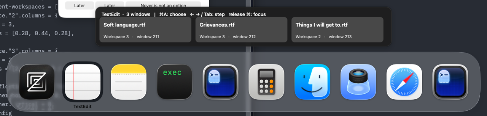
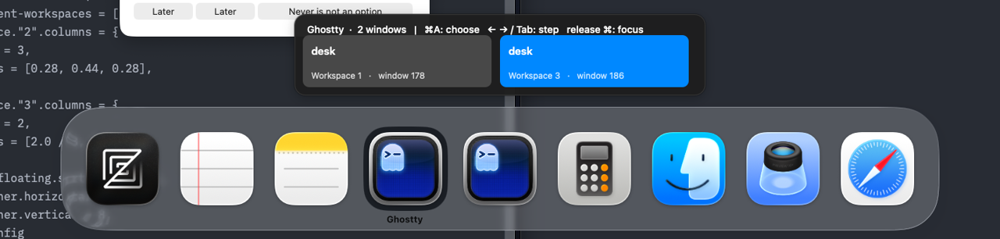

# A window row above the system's Cmd-Tab

The standalone prototype works on macOS 26.6.2: it reads the system highlight, follows it with window Tiles, takes Cmd-A into the row, and focuses a chosen window on a hidden workspace after the system switches. The recommendation is **drop this approach for now**. The measured opening misses the accepted 150 ms budget, the required focus ordering exposes an intermediate window, and Secure Input removes keyboard entry into the row.

This directory changes no WinMux behavior. It contains three standalone Swift programs and guest proof drivers, with no added tests, setting, dependency or shipped asset. The feature decision “off by default, behind one setting” remains a condition of any future feature. The prototype has no setting. No DockDoor repository was opened, fetched or cloned, and none of its code or assets was used.





## What ran

The assigned guest ran at 1920 × 1080, 1×, with Xcode 27's Swift 6.4. Xcode's version is separate from the operating system. Guest `sw_vers` returned:

```text
ProductName:            macOS
ProductVersion:         26.6.2
BuildVersion:           25G83
```

**macOS 27 was not run.** Neither were an installed signed build, a physical keyboard, another display, or real sleep/wake/unlock. Those checks remain unticked in the original issue draft if the idea is reconsidered.

Host and guest `make check` passed before the live run: 1,506 Swift tests and 90 Rust tests each; the Python suite ran 171 tests, with the expected committed-hash check skipped in the synced guest (`.source-commit` represents the host working copy), and none skipped on the host. These checks establish the existing branch's checks, not a test suite for this throwaway program, and do not establish a CI pass.

The rich desk staged fourteen windows. The literal `system-desk.ncl` is its config with only the three switcher bindings removed (comments and whitespace also differ). After reload, `doctor` reported `Symbolic hotkeys: held=[] marker=[]`. This stayed true through the live runs. A `cliclick kd:cmd kp:tab w:1500 ku:cmd` hold opened the real system switcher; `cliclick-system-switcher.png` records it before the row ran. There was no need for the alternate driver to rescue a failed hold. Subsequent experiments used the demo skill's `keys` and `film` tools.

One Ghostty window, id 186, was moved from workspace 1 to workspace 3. Its other window, id 178, stayed on workspace 1. Both have title `desk`, but different pids and the same bundle id. Safari's three windows stayed on workspace 2. Full inventories and every take's app/window mapping are in the relay's `captures/index.md`; raw captures and JSONL logs are deliberately outside this public repository.

For the unchanged-build comparison, `ac4b957f` was archived into a second guest directory, built there with `make generate`, `make helper` and `swift build`, and launched separately. `compare-build.sh` ran against both trees. The complete fourteen-window inventories, including workspace assignments, matched byte for byte; both ended focused on window 168 with no symbolic hotkeys held. The archive's doctor hash is `unknown` because its initialized Git repository has no commit; the synced tree reports `ac4b957f`.

## The Dock element, found independently

`dock-probe.swift` obtains the Dock pid from `NSRunningApplication`, creates its AX application element and walks children recursively. This is the relevant part of the real dump; object addresses are omitted:

```text
AXApplication title=Dock position=(0,0) size=(0,0)
  AXList subrole=nil position=(143,1080) size=(1634,72)
    AXDockItem subrole=AXApplicationDockItem title=Finder selected=0
    ... ordinary Dock items ...
  AXList subrole=AXProcessSwitcherList title=nil
    position=(269,452) size=(1382,176) selected=nil focused=1
    AXButton title=Zed      position=(293,476)  size=(128,128) selected=nil
    AXButton title=TextEdit position=(427,476)  size=(128,128) selected=nil
    AXButton title=Notes    position=(561,476)  size=(128,128) selected=nil
    AXButton title=Updater  position=(695,476)  size=(128,128) selected=nil
    AXButton title=Ghostty  position=(829,476)  size=(128,128) selected=nil
    ... Calculator, Finder, Preview, Safari, second Ghostty ...
```

The children do not expose `AXSelected`; the list exposes **`AXSelectedChildren`**, whose first element's `AXTitle` is the highlighted app. In the first dump it was TextEdit. A second dump read Zed. The list also exposes `AXFrame`; its frame changes with the number of app icons after a Dock restart. The full original dumps preserve role, subrole, title, description, position, size, selected state and value.

An `AXObserver` was attached to the Dock first. The standalone observer run identified these notification senders:

```text
AXSelectedChildrenChanged role=AXList subrole=AXProcessSwitcherList
AXCreated                 role=AXList subrole=AXProcessSwitcherList
AXFocusedUIElementChanged role=AXList subrole=AXProcessSwitcherList
AXUIElementDestroyed      role=nil    subrole=nil
```

Registration on the Dock succeeds for those four notifications. Registration directly on the list succeeds for `AXSelectedChildrenChanged` and `AXUIElementDestroyed`. Direct list registrations of `AXValueChanged`, `AXFocusedUIElementChanged` and `AXLayoutChanged` return `-25207` (notification unsupported). Invented `AXProcessSwitcherActivated` and `AXProcessSwitcherDeactivated` names are also unsupported. Destroyed elements cannot be read back for their role.

The prototype therefore uses observer callbacks to read highlight changes and disappearance. A 5 ms timer discovers the list while Command is held, checks release independently, and polls active state if no observer could be attached. It does not need continuous tree polling for highlight updates once an observer is attached. Notifications can arrive twice because the prototype registers on both application and list; reads are deduplicated by selected AX element identity, including two Ghostty icons with the same title.

## Timing

These are the first twelve sessions in `prototype-final.jsonl`, summarized by `summarize.py`. Each session starts on Zed; the driver steps TextEdit → Notes → Ghostty → the second Ghostty process → Shift-Tab back to the first Ghostty. It cancels with Escape between samples. The timer and observer do no CLI work on highlight changes.

| Measurement | Samples | Minimum | Median | Maximum |
| --- | ---: | ---: | ---: | ---: |
| Opening Tab timestamp → first successful app read | 12 | 158.005 ms | 166.958 ms | 177.754 ms |
| Further Tab timestamp → changed highlight read | 36 | 0.942 ms | 2.038 ms | 4.707 ms |
| Shift-Tab timestamp → changed highlight read | 12 | 0.839 ms | 2.600 ms | 3.407 ms |
| One CLI window snapshot | 12 | 18.026 ms | 30.129 ms | 34.695 ms |
| Opening Tab timestamp → first row ordered/displayed by AppKit | 12 | 181.200 ms | 196.964 ms | 213.810 ms |

The origin is the **event tap's received event's `CGEvent.timestamp`**, on the same boot clock as the AX read, rather than the time the callback finally ran. `keys.swift` stamps and posts the event at the HID tap and uses a 15 ms inter-action delay. These synthetic measurements include posting, scheduling and WindowServer delivery and are upper bounds for this driver, not claims about physical keyboard latency. `cliclick` was used for the prerequisite hold and pointer faults, not this sample table; it adds 100 ms between actions.

The last row measures AppKit ordering and drawing, **not a calibrated on-glass presentation time**. The recordings confirm that it appears and follows the apps, but their variable frame rate is unsuitable for claiming a more precise display latency. Even ordering misses the strip's accepted “on screen about 150 ms” budget in every measured opening. Later changes are fast. Integrating with WinMux could remove the external CLI's roughly 30 ms, but no measurement here proves that integration or a 150 ms presentation. The Dock's first readable highlight is itself later than 150 ms in this guest run.

Exactly one `list-windows --all` snapshot was made in each of the final program's 23 sessions, including navigation, faults and Secure Input. The snapshot requests window id, app name, pid, bundle id, title and workspace, then filters locally. No per-highlight `winmux` commands run. This avoids both the CLI's latency and the known refresh cancellation in **A read-only command drops the refresh it cancels, and a new window stays unmanaged**. New windows appearing mid-session wait for the next session.

## The panel and keyboard contract

`window-row.swift` creates a borderless `.nonactivatingPanel`, with `canJoinAllSpaces`, `fullScreenAuxiliary`, `transient`, no hiding on deactivation, and a level one above the screen-saver level. It never becomes key or requests activation. Tiles contain title and workspace; no thumbnail permission or picture work is added. The prototype filters by the selected app's display name, intentionally showing both Ghostty processes together. A future feature would need an unambiguous app/bundle association for unrelated applications with identical names; this prototype does not establish that association.

The panel's placement uses the switcher list's AX frame and a 16-point gap above it. A Dock window from `CGWindowListCopyWindowInfo` is coded as a fallback; the AX frame worked in all live takes, so the fallback is unverified. Every `row-show` logs both rectangles, overlap, key-window state, windows and front app. All final logs have `intersects=false` and `key=false`. This geometry covers the single 1920 × 1080 display only. More windows than fit in the fixed-width prototype Tiles are outside this experiment.

Cmd-A is retained. The **active session event tap** sees Cmd-Tab itself, in both directions, and passes it. The WindowServer's precedence over Carbon hotkeys does not mean that this CGEvent tap cannot observe the event. It swallows only Cmd-A while the list is open and, after entering the row, arrow keys and Tab key-down/key-up pairs. It never changes or swallows `flagsChanged` events. While the switcher is down it returns every event unchanged. All four arrows, Tab and Shift-Tab were exercised in `navigation.mov`.

The owned input canary received Cmd-A before and after the switcher session and selected all its text. During the session it received Command's modifier events but no A event; the prototype logged both swallowed A events. Cmd-A and row navigation kept the native switcher open and its highlight unchanged, visible in `hero.mov` and `navigation.mov`. A row entry initially chooses the first Tile; navigation changes it. Escape remains the system's event and cancels the row's pending focus too.

With no Tile chosen, Command release only hides the panel: the prototype issues no focus command. `no-choice.mov` ends on the app the system selected. With a chosen Tile, Command release passes unchanged, hides the row, and schedules a sample of the system result 100 ms later. Only then does it run `focus --window-id` asynchronously.

The final hero's boot-clock sequence is:

```text
1294.306847  Command release: selected window 186, workspace 3; modifier passed
1294.418752  system result: Ghostty pid 8486, desk, frame (989,42,919,1025)
1294.713789  focus --window-id 186 returned 0; command took 294.982 ms
1294.874166  post-focus sample: Ghostty pid 8499, desk, frame (65,78,1221,986)
```

Inventory identifies pid 8486 as window 178 on workspace 1, and pid 8499 as window 186 on workspace 3. CLI readback ends on workspace 3 / window 186. The film shows the intermediate workspace-1 window before the hidden-workspace destination, with a transition through the workspace-3 layout. This flash is a finding, not a seamless switch. The 100 ms delay is a prototype choice, not a proven minimum safe delay for a feature.

An app with no listed windows gets **no row**, to avoid offering a dead action. `empty-app.mov` closes Finder's only window, keeps Finder running, highlights Finder and presses Cmd-A. The snapshot contains thirteen other windows, the row stays hidden, and no focus is issued.

## Clicks, pointer crossing, Secure Input and the Dock

Clicking a Ghostty Tile once while the switcher was held closed the system switcher, switched nothing, and removed the row. Zed remained focused. This avoids the stranded overlay fault; the prototype deliberately does not implement click selection. Clicking elsewhere inside Zed also closes both overlays. A built feature would need either explicit click cancellation with a clear keyboard-only affordance or an independently validated click action. It must always tie overlay lifetime to the Dock's list, including mouse exits.

Moving the pointer from below the switcher through the icon band and up to the row changed the native highlight from Ghostty to Notes, and the row followed Notes. A feature cannot treat that crossing as a window-selection gesture without first resolving this hazard. Merely making the row ignore mouse input would not prevent the system's icon hover. Do not promise mouse support from this prototype.

`input-probe.swift --secure` called `EnableSecureEventInput()` successfully and remained frontmost with `IsSecureEventInputEnabled() == true`. Under Secure Input the prototype's tap received Command and Shift flag changes but **no Cmd-A or Tab key events**. The Dock continued to handle Tab/Shift-Tab; AX reads and observer callbacks continued to report Zed → Ghostty → Zed, and the row followed. Cmd-A could not enter the row, no Tile was chosen, and Escape removed the row. The canary did not receive an A event either. A feature would need an explicit degraded display-only policy or hide the row under Secure Input; this experiment supplies no working row-entry fallback.

Dock restart was tried idle and during a hold. Running-application-list KVO detects exit and relaunch; `isFinishedLaunching` gates attachment, with a 500 ms retry for a refused observer registration. The first version released its Dock object before invalidating that object's KVO observation and died. The final version invalidates it first and passed both restart takes. On a held restart it cancels the pending choice and orders the row out.

From the final log's observed Dock disappearance to successful observer attachment: **188.741 ms idle, 230.755 ms held**. The idle take deliberately waits three seconds before its next gesture; its next row is ordered 212.037 ms after opening Tab. The held take retries after releasing Command and waiting one second; the next row is ordered 222.244 ms after opening Tab. Those are scheduled trial intervals, not measurements of the earliest possible successful retry. The prototype must see a fresh Command/Tab gesture before reopening after an exit, so a fading old list cannot create a second snapshot session.

## Reproduction and evidence

Run this only in the assigned guest, with the VM skill's environment and permissions already prepared. Set the host's `TART_HOME` to the driver-provided storage directory in every shell. Use the VM script for every guest operation. Do not use Tart's guest agent or grant prompts.

```sh
VM=.claude/skills/vm/vm
P=.scratch/winmux-fork/prototypes/32-window-row-above-cmd-tab
"$VM" sync relay-114 "$PWD"
"$VM" build relay-114
"$VM" check relay-114
"$VM" push relay-114 .claude/skills/demo/desk desk
"$VM" push relay-114 "$P" row-prototype
"$VM" ssh relay-114 'bash ~/row-prototype/prepare.sh'
"$VM" ssh relay-114 'swiftc ~/row-prototype/window-row.swift -o ~/row-prototype/window-row'
"$VM" ssh relay-114 'nohup ~/row-prototype/window-row > ~/takes/row/prototype.jsonl 2>&1 < /dev/null &'
"$VM" ssh relay-114 'bash ~/row-prototype/pilot.sh'
"$VM" ssh relay-114 'pkill -x window-row'
"$VM" ssh relay-114 'nohup ~/row-prototype/window-row > ~/takes/row/prototype-final.jsonl 2>&1 < /dev/null &'
"$VM" ssh relay-114 'bash ~/row-prototype/measure.sh'
"$VM" ssh relay-114 'bash ~/row-prototype/hero.sh'
```

`prepare.sh` stages the rich desk, loads the literal config, prints doctor, compiles the AX probe, and captures the initial system hold. The other shell drivers are the recorded fixture scripts: **their window ids are those of this run**. Before invoking `pilot.sh` or the remaining drivers on a restaged desk, map the inventory and replace those fixture ids, including the two Ghostty ids in `pilot.sh`, `measure.sh` and `hero.sh`. `pilot.sh` explicitly moves one Ghostty to workspace 3 and records the resulting inventory. The stop/restart above gives measurement session 1 a fresh log; run `measure.sh` first so its twelve samples occupy sessions 1–12.

After the hero, the evidence run used `faults.sh`, `input-run.sh` and `navigation.sh` in that same prototype process. It then stopped the prototype, ran `compare-build.sh <tree> <label>` once per separately built tree, and started the prototype again into `prototype-empty.jsonl` for the observer probe and `empty-app.sh`. The first outside-click take highlighted windowless Finder, so it was replaced: the rich desk was restaged and `cleanup.sh` explicitly focused Ghostty before Zed, recording the visible-row dismissal into `prototype-outside.jsonl`. That final retake has new fixture ids (Ghostty 658/666 on workspace 1), separate from the hidden-workspace hero. `summarize.py <log>` recomputes the timing table from sessions 1–12 of `prototype-final.jsonl`. Run long commands in the background, wait with one long yield at a time, and pull `takes/row` only after the recorder finishes.

`captures/index.md` maps every accepted movie, screenshot, transcript and log to its checked result. Earlier `prototype.jsonl`, `prototype-v2.jsonl`, `prototype-v3.jsonl` and the failed Dock run are diagnostic history. The accepted measurements and hero use `prototype-final.jsonl`; the later observer/empty run uses `prototype-empty.jsonl` and the visible-row outside-click retake uses `prototype-outside.jsonl`. Committed stills are crops of real guest captures, 211 KB and 224 KB, with only staged content.

## Recommendation

**Drop it for now.** Keep the standalone evidence; add no WinMux setting or feature issue. The row can be built technically, but this guest run does not justify the interaction: even its first AX read misses 150 ms, the complete row orders at a median 197 ms, and choosing a hidden window visibly passes through the system's different choice. Secure Input leaves a displayed row that the entry key cannot operate. Pointer crossing changes its target.

Reconsider only with physical-keyboard and installed-build measurements showing a first row on screen around 150 ms, a tolerable or eliminated intermediate-window flash while preserving system release, and an explicit Secure Input policy. macOS 27 and multi-display behavior must then be checked. Faster later highlighting alone would not change this recommendation.
