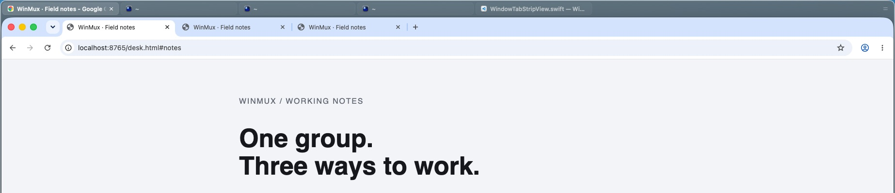
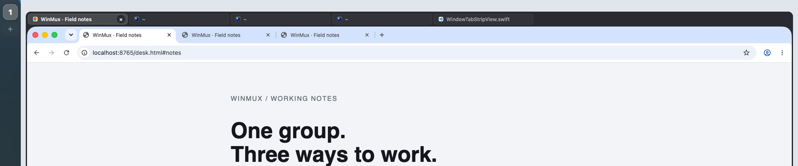
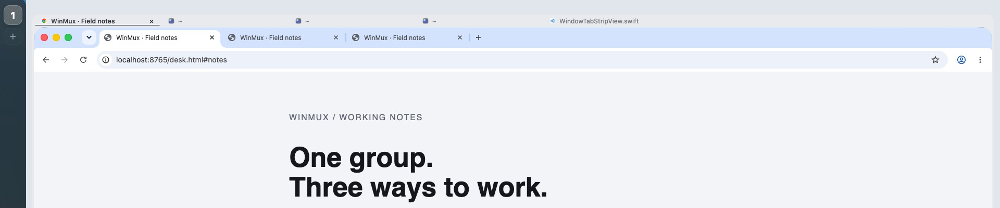
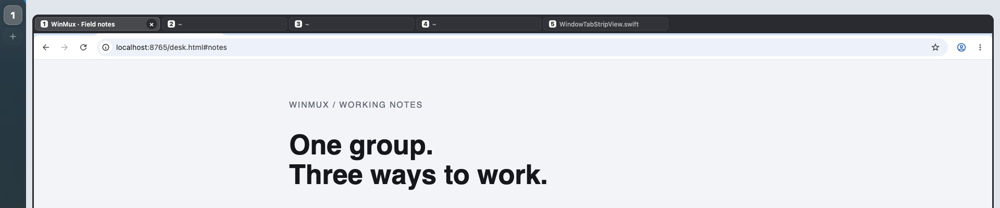
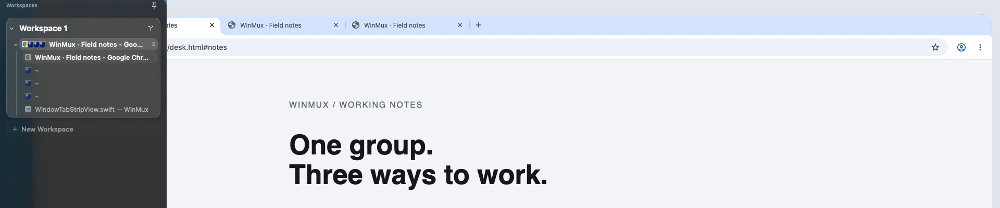
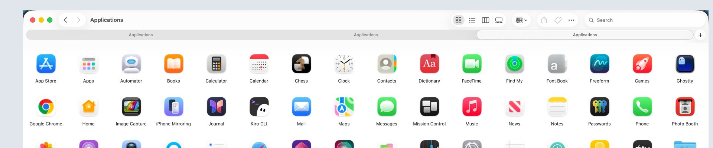

# The tab strip above app tabs

Choose how much WinMux chrome belongs above an app that already has tabs. Open
[the working page](index.html) from disk; it needs no server, build or network.
The redrawn pictures use the same Chrome capture, crop and point scale; the first, captured from WinMux, has no sidebar rail and its strip at the top edge.


Today, captured from WinMux itself: the strip's glass takes its tint from what is behind it. The redrawn Today below is a fixed dark, and the redrawn Thin band takes Chrome's own colour.


Today, redrawn: 36 points, filled pills and a frame; removing the grip leaves the familiar strip.


Thin and quiet: 24 points, unfilled labels and an active hairline; keep direct pointer access. The band is drawn in the app's colour here; draft 129 keeps today's glass colours and takes only this geometry.


Only while held: zero points at rest; Option reveals a 36-point overlay after 500 ms.


Sidebar only: zero points above the app; hover the rail to find the group and its tabs.


Baseline osx: Finder's three stock window tabs, captured at the group's size.

**Recommendation: Thin and quiet, grip gone.** It saves 12 points and removes the
frame and filled pills while keeping group membership and pointer switching
visible. The gutter and empty strip already drag the whole group. This is the
relay's recommendation; Prateek's pick still decides the feature.

Fidelity limit, from the outset: the page draws CSS over captures. Animation
curves, blur and vibrancy, exact font rendering, scroll fades and close-button
hover timing approximate the native strip. The app bodies are still pictures;
the close glyph illustrates hover and does not close an app. The sidebar crop
retains its captured backdrop instead of reblurring over each variant. Drag targets name
their action without moving native windows. None of the answers below depends
on those approximations. The Thin band's colour follows each app in the page; that is illustration, and draft 129 keeps today's `chrome-style` fill. Both page themes work; captured app and native sidebar
themes stay as captured.

The grip comparison has a [clear handle for Today](img/pick-today-clear.png),
[Thin](img/pick-thin-clear.png), [Held](img/pick-held-clear.png), and
[Sidebar](img/pick-sidebar-clear.png). The held pictures show the deadline
reached; [its rest picture](img/pick-held-rest.png) has neither strip nor handle.
The sidebar pictures show hover expansion so its handle treatment is visible.
In that treatment the label overlays the existing group header, without adding
a new row. All pick PNGs are 1920 × 400, one pixel per logical point.

## What was captured

The native baseline is WinMux at `7c7c9648`, in a 1920 × 1080 guest at backing
scale 1. Chrome 155.0.8059.85 and VS Code 1.142.0 were installed in that guest
only. Chrome has three loopback-served local pages; VS Code has
`WindowTabStripView.swift`, `WindowTabMetrics.swift` and `WindowTabHintState.swift`
open as editor tabs. Ghostty has three tabs made with Cmd-T, each with neutral
test-result content. Orca is skipped: it is Prateek's own tool and is not
installable in this guest.

Ghostty's native macOS tabs expose three AX windows. WinMux therefore lists five
entries across the three apps, in this order: Chrome, Ghostty, Ghostty, Ghostty,
VS Code. The page retains that count and ordering rather than inventing a
three-entry native baseline. The terminal images show the middle native tab;
the other two have the same staged content. Clicking their page entries changes
the selected label while retaining the terminal capture.

The group was staged by hand. `join-with` makes a split, rather than a tab group.
The exploratory joins and final conversion actually run were:

```sh
winmux join-with --window-id 252 right
winmux join-with --window-id 252 left
winmux join-with --window-id 252 left
winmux join-with --window-id 252 left
winmux layout --window-id 252 h_tab_group
winmux flatten-workspace-tree
winmux layout --window-id 201 h_tab_group
```

The last two commands put all five leaves in one root group on workspace 1.
Here `winmux` means the guest's `.build/debug/winmux`, not an installed CLI.
The authoritative command definitions are
`Sources/Common/cmdArgs/cmdArgsManifest.swift:27–28` and
`cmdArgs/impl/LayoutCmdArgs.swift:21–29` at `7c7c9648`.
[The raw agent readback](raw/agent.json) and [window list](raw/windows.txt)
retain the actual group, membership, titles and frames. No desk staging script
was used.

Today's native rest, tab hover, grip hover and Option-held pictures are selectable
above the stages. [The full group frame](img/group-frame.jpg) includes its sides
and bottom. The native grip has no separate hover treatment in its view code;
that capture deliberately looks like rest. Option was held with the demo
skill's `keys`, `down:alt wait:1.0 up:alt`, with a still taken 700 ms into it.
Each application was allowed to draw before its captures and read back once
afterwards. There was no WinMux read polling during discovery.

Finder and [ungrouped Ghostty](img/native-ghostty.jpg) each have three stock macOS
window tabs. Both native windows were sized to 1846 × 1025 points at the same
origin as the WinMux group, with WinMux quit. Finder's sidebar was hidden to
keep its comparison about tabs. Its stock tab row is 28 points tall, below its
toolbar; Ghostty's AX tab group is also 28 points, below 32 points of title chrome.

## Measured metrics

`M` in `index.html` is the shared metric table for the drawings, displayed table
and self-checks. Source references in this document are at `7c7c9648`.

| Element | Points / value | How established |
| --- | --- | --- |
| Strip | 36 | CG panel bounds in [metrics.json](raw/metrics.json), capture y=42 to 78; `WindowTabMetrics.swift:21–22` floors config at 36 |
| Group / active app | 1846 × 1025 / 1840 × 986 | Native tree and captures: group (62,42), app (65,78); 3-point side/bottom shell, no top gap |
| Pill | 240 × 26 | Capture edges x=67,311,555,799,1043; top y=47; constants and `WindowTabStripView.swift:159` |
| Spacing | 4 | 244-point pill pitch minus 240; `WindowTabStripConstants.swift:16` |
| Preferred / minimum width | 240 / 132 | Constants:21–22; 240 measured here, 132 read only because this group does not overflow |
| Reserved grip | 24 | Constants:12 and SupportViews:62; visually bounded by the trailing grip region; hit-area width read from code |
| Two capsules | 9 × 1.5, gap 2.5, white 22% | `WindowTabStripSupportViews.swift:51–56`; visual position checked, subpixel height/alpha read from code |
| Trailing drag gutter | 28 | Constants:13, StripView:171–179; invisible hit target verified by a live drag, width read from code |
| Top strip / pill corner | 12 / 7 | Constants:14–15 and `DesignTokens.swift:43`; curvature checked visually, exact radius read from code |
| Outer / inner frame stroke | 0.5 / 0.5 | Constants:26–27, `WindowTabGroupFrameView.swift:27,39`; frame captured, subpixel widths read from code |
| Item height | min(max(height − 10, 18), 26) | StripView:159: 26 today and 18 in the proposed 24-point bar |
| Hint deadline | 500 ms | `WindowTabHintController.swift:11`; native and Safari stills taken after that deadline |

This distinguishes independently measured edges from source values: a 1× JPEG
does not independently establish a half-point stroke or a 22% alpha under glass.
The untouched full-resolution PNGs remain in the driver's evidence; the page
uses JPEG crops to stay below 5 MB. App icons were obtained from their installed
guest bundles and reduced to 32 × 32 pixels.

The parser refuses heights of 20 or less (`config/parseWindowTabs.swift:16–18`).
An accepted 24 is still floored at 36 by `WindowTabMetrics.swift:21–22` today.
The proposed Thin height requires a feature change; editing the config alone
cannot produce this look.

## Space above the app's tabs

Each cell gives **WinMux strip + gap / distance to the app's tab row**, in points.
The second number includes the app's own title chrome: Chrome 0, VS Code 36,
Ghostty 32. Those native insets stay inside the captured app, rather than being
mistaken for extra WinMux spacing. Grip treatments change no vertical size.

| Look | Chrome | VS Code | Ghostty |
| --- | --- | --- | --- |
| Today | 36 + 0 / 36 | 36 + 0 / 72 | 36 + 0 / 68 |
| Thin and quiet | 24 + 0 / 24 | 24 + 0 / 60 | 24 + 0 / 56 |
| Only while held, rest | 0 + 0 / 0 | 0 + 0 / 36 | 0 + 0 / 32 |
| Only while held, revealed | 0 + 0 / 0 | 0 + 0 / 36 | 0 + 0 / 32 |
| Sidebar only | 0 + 0 / 0 | 0 + 0 / 36 | 0 + 0 / 32 |

Held reveals a 36-point overlay without moving the app. It covers Chrome's tab
row, VS Code's title chrome and the first four points of Ghostty's tab row while
the modifier remains held. Its zero reserved height is a trade-off, not free space
for an additional row. The page's working-stage footer reports these numbers.

## Answers to the four questions

### Without the grip, where does a whole-group drag start?

Today and Thin retain empty strip chrome outside the pills and the 28-point
trailing gutter. Native code already installs those gestures: the scroll
background's drag is defined at
[`WindowTabStripView.swift:54–85`](https://github.com/prateek/winmux/blob/7c7c9648/Sources/AppBundle/ui/tabs/WindowTabStripView.swift#L54)
and attached at line 275, and the gutter's at 171–179. `tabChromeGroupDragGesture`
(87–120) is attached nowhere. In an overflowing strip the scroll background has
no empty area, so without the grip the gutter and Option-dragging a tab (`WindowTabStripGroupDragPolicy.swift:2–12`) are what is left.
The old grip is a third target, and clicking it focuses the group
([SupportViews:46–86](https://github.com/prateek/winmux/blob/7c7c9648/Sources/AppBundle/ui/tabs/WindowTabStripSupportViews.swift#L46)).

Both native starts were exercised: x=1853 in the gutter, and x=1450 in empty
chrome after the fifth tab, at y=60. Each drag opened the sidebar, targeted
New Workspace, and moved all five leaves together. The preview's five-entry
group, final window lists and [gutter](raw/drag-gutter.json) /
[empty-space](raw/drag-empty.json) trees agree. The first reset attempt moved
only one window; it was discarded and the final driver rebuilds the complete
fixture before each case.

Held can use its empty chrome/gutter while revealed. With no strip at rest it
uses the expanded sidebar's tab-group header. Sidebar uses that header in both
grip treatments. This target exists today:
[`WorkspaceSidebarWorkspaceSection.swift:520–563`](https://github.com/prateek/winmux/blob/7c7c9648/Sources/AppBundle/ui/sidebar/WorkspaceSidebarWorkspaceSection.swift#L520)
passes the stable container identity to `tabGroupDragChanged/Ended` and the
native drag payload; [TreeRows:72–76](https://github.com/prateek/winmux/blob/7c7c9648/Sources/AppBundle/ui/sidebar/WorkspaceSidebarTreeRows.swift#L72)
uses that header for a tab group. The page's clear treatment labels that row
“Drag group · 5”. It proposes no persistent floating handle in Held's rest state.

### With no strip, how do you see the group and reach another tab?

Held's working stage shows no group label at rest. Hold Option for 500 ms to
reveal the strip, then click a tab or use its digit; release hides it. A quick
key/click before reveal spoils the pending hold until all modifiers are up.
The page follows the actual `WindowTabHintState.swift:11–37`: activity after
display leaves the hints available, which permits pointer selection. A feature
would reuse that reducer and `WindowTabHintController` rather than add a second
modifier timer.

Both zero-height looks also allow rail hover, then a click on a child window
row. Without that hover or the held reveal, membership is undiscoverable in
the compact rail. That is why Thin is the recommendation.

### What does the collapsed sidebar show?

Only the workspace number. [Collapsed](img/sidebar-collapsed.jpg) and
[expanded](img/sidebar-expanded.jpg) are crops of the real native sidebar for
this group. Expansion shows one group header with count 5 and its five windows
under a child rail. The issue's wording “leans on” the sidebar prototype is
outdated: **The sidebar as a tree** has since been built. This page uses its
debug build, never the older prototype's page.

### How does each compare with macOS and a browser?

The opening pictures, native baselines and small stages share point scale.
Today gives the strongest enclosing group, but makes another filled tab row
above Chrome. Thin still has two rows, but the group becomes a quiet label band.
Held removes the extra row until needed and then temporarily covers native
chrome. Sidebar leaves the native app alone and moves all group access to hover.
Finder and Ghostty show that native window tabbing already occupies another
row below title chrome. None of these proposals places WinMux tabs inside an
app's native title bar.

## Checks and evidence

Open `index.html?selftest` for 46 geometry and hint-state rows. The checks include
each look's height, pill geometry, spacing, gutter, the native capsule geometry,
the clear handle and the 499/500 ms boundary, release and spoiled holds.
`node check-browser.mjs <capture-directory>` drives task-owned headless Chromium.
It checks the 24 app/look/grip combinations plus real pointer/key interaction,
themes, the native-state selector, small-stage selection and affordance messages.
A complete run reports 44 browser checks.
A negative control changes Thin to 36 at runtime; its height/item/gap checks fail,
then reloading restores the passing page.

Guest Safari is opened from disk on the same 1920 × 1080 display. Its evidence
covers all 24 combinations, an actual Option-held reveal and release, a pointer
app switch/tab hover, handle hover and rail expansion/collapse. Shareable Safari
stills crop only the address and tab toolbar, retaining the page at its rendered
scale. The capture scripts and page-only AX reader are under `tools/`.

Host and pinned Swift 6.4 guest `make check` pass: 1,741 Swift tests, 92 helper/Rust
tests and 171 Python script tests. The guest skips the existing committed-hash
test for its sync commit. These are local checks, not GitHub CI. No shipped
source, helper, script or documentation file changed. The builder committed
locally; the driver owns publication, CI and landing. No release was published.

The recommendation is written as
[Thin, quiet tabs above grouped windows](../../build/129-thin-quiet-tabs-above-grouped-windows.md).
It explicitly waits on Prateek's pick and can be replaced by it. Installed-build
use, a second display and real sleep/wake/unlock remain his feature checks.

## Decisions recorded for the relay

Decided: Recommend a 24-point Thin and quiet strip with the grip gone, awaiting
Prateek's choice. Keep the 28-point gutter and empty-chrome group drag targets.

Decided: Retain Ghostty's five-entry group baseline across the three apps,
including the three native terminal tabs that WinMux enumerates separately.

Decided: Follow the source reducer's pre-reveal spoil rule; activity after the
deadline keeps hints usable until release. A feature reuses that existing seam.

Decided: Show the clear handle only while Held is revealed, and label the
existing sidebar group header for Sidebar. Neither zero-height look gains a
persistent on-window handle at rest.

Decided: Report added WinMux height separately from native title-chrome insets,
and retain JPEG crops plus full-resolution pick PNGs under the 5 MB limit.

The issue has no named **Defaults chosen for you** section. None was changed.
