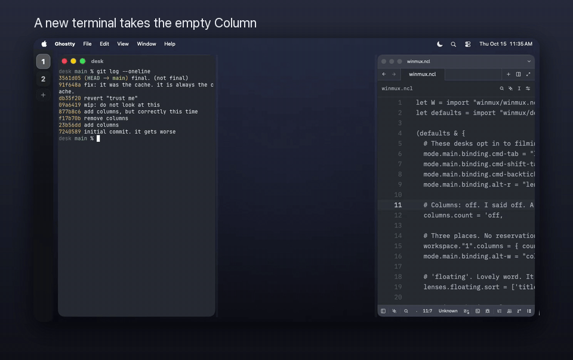
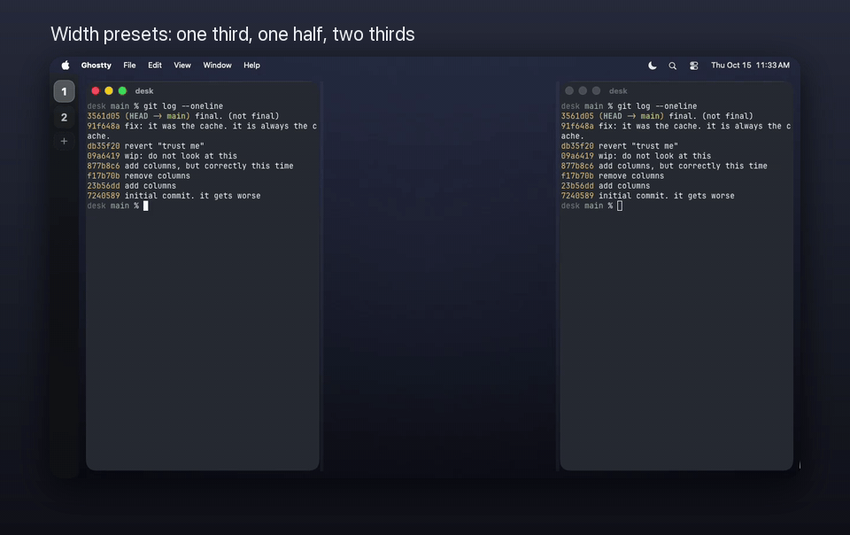
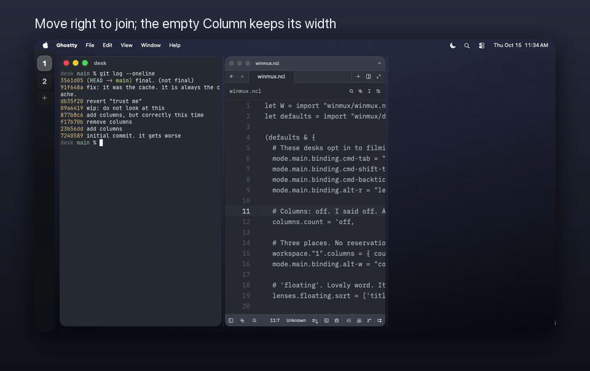
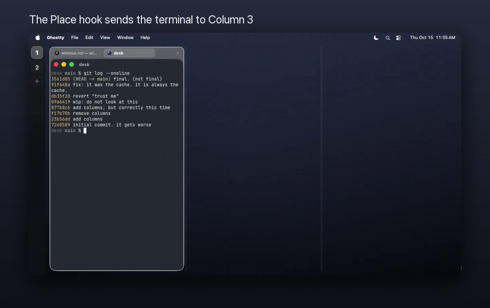

# Fixed Columns

A workspace with Columns has a fixed number of positions across its monitor. Each position keeps its width when empty. A Column can hold one window, a tab group, or splits. Columns are off by default.

A new window lands in the nearest empty Column; the others keep their places.



`column-width next`, bound to Option-W in this demo's config, steps the focused Column through its width presets; the others give up room in proportion.



Moving into an occupied Column joins its tab group and leaves an empty gap behind.



A `place` hook sends the new terminal to Column 3: `place = fun w ctx cols => if w.app.name == "Ghostty" then { column = 3, overflow = 'tab-group } else { column = 'nearest-empty, overflow = 'tab-group }`.



## Enable Columns on a workspace

```nickel
let W = import "winmux/winmux.ncl" in
((import "winmux/defaults.ncl") & {
  columns.count = 'off,
  workspace.Demo.columns = {
    count = 3,
    widths = [1.0 / 4, 1.0 / 2, 1.0 / 4],
  },
}) | W.Config
```

This enables Columns only on the workspace named `Demo`. Workspace names refer to existing or subsequently created workspaces; the record does not create a workspace. Omitting `widths` gives equal widths. Widths must be positive, and their length must equal the resolved count. Values that do not sum to 1 are normalized proportionally, with a warning from `winmux config check` and when loading the config.

## Defaults and overrides

```nickel
let W = import "winmux/winmux.ncl" in
((import "winmux/defaults.ncl") & {
  columns = {
    count = 3,
    widths = [1.0 / 3, 1.0 / 3, 1.0 / 3],
    width-presets = [1.0 / 3, 1.0 / 2, 2.0 / 3],
    when.default.widths = [1.0 / 4, 1.0 / 2, 1.0 / 4],
    when.travel.count = 4,
  },
  workspace.Demo.columns = {
    count = 2,
    widths = [1.0 / 2, 1.0 / 2],
    when.default.widths = [1.0 / 3, 2.0 / 3],
  },
}) | W.Config
```

Settings resolve field by field, in this order: `columns`, `columns.when.default`, `workspace.<name>.columns`, then `workspace.<name>.columns.when.default`. Only the `default` profile matches. Other profile records load but do not apply. `width-presets` belongs only to top-level `columns`; putting it under a workspace or any `when` record is an error. The default presets are 1.0 / 3, 1.0 / 2 and 2.0 / 3.

A reload resets current widths to the declared widths. Lowering the count folds the extra Columns' windows into the retained Columns' tab groups. Setting `count = 'off` restores ordinary tree tiling.

## Placement, movement and focus

New tiling windows use the nearest empty Column from the focused one, with ties going left. When all Columns are occupied, arrivals join the focused Column as a tab group. When focus is elsewhere, placement uses the most recently used Column. The ordinary automatic tab-group arrival setting does not override this behavior.

Closing a window leaves a gap rather than shifting its neighbours. `focus left` and `focus right` skip empty Columns. A focused empty Column has a faint outline and receives the next arrival. Use `focus-column <n>` to select an empty Column.

`move left` and `move right` move the focused window across a Column boundary. An empty neighbour takes it alone; an occupied neighbour takes it into a tab group. Movement within a split keeps the ordinary tree behavior. Swapping Columns exchanges their positions; swapping within a Column keeps its position.

Dragging a tiling window onto another Column previews its resolved placement. Without a `place` hook, the drop fills the pointed Column or joins its tab group when occupied. With a hook, the pointed Column supplies the `'focused` target and nearest-empty anchor; the hook's `column` answer outranks the pointer, and a hook that fails leaves the pointed Column. A dragged tab group stays one group in an empty Column and in the lower half of a split; joining an occupied Column merges its windows into that Column's tab group, and a float floats each of its windows. The overlay outlines an empty Column or the whole occupied Column for `'tab-group`, its lower half for `'split`, or the rightmost extra Column for `'squeeze`. A resolved `'float` placement hides the Column overlay and floats the window where it is released. While the hook is pending, the preview shows the pointed Column with tab-group Overflow; releasing before the answer arrives applies that placement immediately, without asking the hook again or running its commands. Drags within the source Column and tab-strip and sidebar drops retain their existing behavior.

At workspace edges, the default move stops. `--boundaries-action fail` returns failure for command fall-through; `create-implicit-container` stops because Columns keep the root horizontal. `--boundaries all-monitors-outer-frame` can move to the next monitor. The same boundary actions apply at a Column's top and bottom.

## Widths

`resize width +40` on a window alone in its Column changes that Column's width. Its other Columns absorb the change in proportion to their widths, including empty Columns. Drag the faint divider at a Column boundary, or a window's edge at one, to use the same proportional operation and preview, including beside an empty Column. The dragged edge follows the pointer. The dividers are left out while the workspace has a floating or fullscreen window, so they never cover one; a window's edge still resizes its Column then. Resizing a split uses the ordinary sizing inside that Column. The minimum Column width is 80 points; when the monitor or the initial width ratios cannot fit every minimum, resizing uses equal fractions.

`balance-sizes` returns Columns to their declared widths and balances splits inside them. Width fractions survive a monitor size change, and gaps remain reserved beside empty Columns.

Width presets and explicit fractions use the same proportional operation. Stepping forward selects the smallest preset above the current width; stepping backward selects the largest below it. Both wrap. Use `column-width next`, `column-width prev` or `column-width 0.5`, including on a window in a vertical split where `resize width` cannot edit the Column.

## Policy hooks

Hooks are pure Nickel functions. `arrive` runs once on detection, before tiling placement; `place` runs whenever a window becomes a tiling window on a workspace. `move-boundary` decides horizontal movement into an occupied Column or across the workspace edge. Each receives a Window record, Filter context and array of Column records; `move-boundary` also receives `edge`, true at the workspace edge. Each Column has `index`, fractional `width`, `empty` and `windows` (Window records). Arrive sees the Columns on the detected workspace, before any routing.

```nickel
let W = import "winmux/winmux.ncl" in
((import "winmux/defaults.ncl") & {
  columns.count = 'off,
  arrive = fun w ctx cols =>
    if w.app.bundleId == "com.example.Editor" then { workspace = "Writing", float = false }
    else {},
  workspace.Writing.columns = {
    count = 3,
    place = fun w ctx cols => { column = 'focused, overflow = 'tab-group },
    move-boundary = fun w ctx cols edge => {
      action = if edge then 'wrap else 'join,
      overflow = 'split,
    },
  },
}) | W.Config
```

`place` requires `column` and `overflow`. Targets are `'focused`, `'mru`, `'nearest-empty`, `'last`, or a positive index. An index greater than the configured count is an error and uses built-in placement. On an occupied target, `'tab-group` joins its tab group, `'split` wraps the contents and arrival in vertical tiles, `'float` floats the arrival, and `'squeeze` adds one extra Column on the right. Its fraction is `1.0 / (count + 1)`, taken proportionally from existing widths. Further squeeze arrivals share that extra Column. When it empties, the invariant removes it and restores declared widths. No other action exceeds the count.

`arrive` may return `workspace`, `float`, `column`, `overflow` and `run`, or `{}`. With no `column`, tiling arrivals fall through to the destination workspace's `place`. An explicit Column bypasses `place`; omitted Overflow policy is `'tab-group`. `float = true` skips `place`, and `float = false` overrides the Accessory floating default. On a workspace with Columns off, Arrive receives `[]`; Place and Move-boundary do not run, including when a global hook is configured. Transfers, drops and cache restoration retain ordinary tree placement.

The Window's `class` describes its binding default before Arrive: a regular tiling window is `tiled`, and an Accessory floating default is `floating`. Temporary holding containers do not change that argument.

Arrive also observes newly detected popups. While a window is in the popup container, `workspace`, `float` and `column` are ignored; `run` still executes. When a popup becomes a real window, Arrive runs once more with its real binding-default class, then destination Place runs as for any tiling arrival.

Arrive replaces `[[on-window-detected]]`. The old key fails loading in both the helper and Swift parser, with one message that names `arrive` and `winmux config convert`. `winmux config convert` leaves the old callbacks as commented Arrive migration suggestions and warns that their matching and command order need translation; it does not silently preserve the callbacks. Define a single Arrive function with the desired branches instead.

Into an occupied neighbour, Move-boundary returns `'join` (with optional `overflow`) or `'swap`. At an edge it returns `'stop`, `'wrap`, `'next-workspace` or `'next-monitor`. An empty neighbouring Column accepts the move without calling the hook. If `overflow` is omitted for a join, Place supplies it. Without a Move-boundary hook, occupied moves join using Place's Overflow policy and the existing `--boundaries` / `--boundaries-action` options govern workspace edges.

Place and Move-boundary resolve over `columns`, `columns.when.default`, `workspace.<name>.columns`, then `workspace.<name>.columns.when.default`. A more specific function replaces a less specific function whole. Other profiles remain inactive.

All three result records may include `run`, an array of config-allowed command strings. Commands run after placement, target the hook's window, and execute in order. A command in `run` still invokes destination placement. A different hook definition's inner list runs to its end before the outer list's next command. A definition is its resolved config path: `arrive`, `columns.place` or, for example, `workspace.3.columns.place`. When that definition already has a list running for this window, only its list is suppressed; binding and placement still happen. This also applies when the two lists overlap from separate commands or tasks rather than nesting. Two overlapping lists from different definitions both run, and their commands can interleave wherever one waits on a hook. Different windows run independently. Each suppression records one hook failure, named by path, in `config status`'s `last-error`.

For a chain, Arrive can move a new Ghostty window to the workspace `Code` through a command, with no `workspace` result field. `Code`'s local Place puts it in Column 2 and sets that Column to half the width, then Arrive's next command steps it to `0.7`. Without the inner list the step would reach `0.4` from the configured third:

```nickel
let W = import "winmux/winmux.ncl" in
((import "winmux/defaults.ncl") & {
  columns.width-presets = [0.25, 0.4, 0.5, 0.7],
  arrive = fun w ctx cols =>
    if w.app.name == "Ghostty" then {
      run = ["move-node-to-workspace Code", "column-width next"],
    } else {},
  workspace.Code.columns = {
    count = 3,
    place = fun w ctx cols => {
      column = 2, overflow = 'tab-group, run = ["column-width 0.5"],
    },
  },
}) | W.Config
```

Routing by Arrive's `workspace` field keeps its existing order: destination Place's list finishes, then Arrive's list starts. Routing by a command in Arrive's `run` list nests the destination's list inside that command, before Arrive's next command.

A loop makes one round trip. Placing a window on `Ping` binds it in Column 2 and moves it to `Pong`. Pong binds it in Column 3 and moves it back. Ping binds it in Column 2 again, then suppresses its already-running list. The window ends on Ping in Column 2, with one failure: `Policy run: workspace.Ping.columns.place is already running for this window; its run list is suppressed`.

```nickel
let W = import "winmux/winmux.ncl" in
((import "winmux/defaults.ncl") & {
  workspace.Ping.columns = {
    count = 3,
    place = fun w ctx cols => {
      column = 2, overflow = 'tab-group,
      run = ["move-node-to-workspace Pong"],
    },
  },
  workspace.Pong.columns = {
    count = 3,
    place = fun w ctx cols => {
      column = 3, overflow = 'tab-group,
      run = ["move-node-to-workspace Ping"],
    },
  },
}) | W.Config
```

These examples use workspace-local Place definitions. Two workspaces sharing global `columns.place` share one definition: a move from its list still places the window at the destination, but suppresses that same path's list there. It cannot chain into itself. Completed lists release the guard, so a later placement can run the definition again. The guard bounds how deep a chain goes, not how many chains a list starts: each moving command in a list can start a chain of its own, so give a list at most one move.

Summon runs Place once per marked tiling window arriving from another workspace, never Arrive. A floating window stays floating. A window already on the destination is focused without being placed again. Floating-to-tiling changes, minimized/native-fullscreen restoration, closed-window-cache restoration, workspace/monitor/project transfers and arriving drag-and-drop windows also use Place. Moving within a Column and closing a window do not call it.

Once Arrive starts, its argument reads, routing, placement and `run` lists finish even if a hotkey cancels the refresh session that detected the window. This includes destination Place, the commands in Arrive's `run` list and popup promotion. Place and Move-boundary calls made for a hotkey or CLI command still follow that command's cancellation.

Window, Filter context and Column records are collected concurrently before the helper request. Every helper hook request has a 50 ms deadline. If a window closes or moves while its hook is pending, the old action is abandoned without an error dialog; Arrive also stops its pending commands if destination Place was abandoned. Timeout, missing helper, raised error or invalid result uses built-in placement/movement. The error is logged and stored as `last-error` in `winmux config status`, without a notification per call. `winmux config check` smoke-runs every configured hook twice, with populated and null context windows, and rejects invalid result contracts with Nickel's diagnostic.

`winmux debug-hooks on` records Arrive, Place and Move-boundary requests, their answers or errors, and argument/helper timings in `hook-capture.jsonl` in WinMux's state directory (`$XDG_STATE_HOME/winmux`, or `~/.local/state/winmux`). Each record holds the window's title and the Filter context's other windows' titles and documents. Previews are captured too: a drag over Columns or a Summon preview calls Place for each destination, so a capture during a drag is mostly preview records. An answer WinMux rejects later, such as a Column past the count, keeps its answer with `error: null`; its failure appears in `config status`. Capture stops itself after 15 minutes. `debug-hooks off` stops it sooner; `subscribe hook-called` streams the same records while it is on. Filters and `config check` smoke runs are not captured.

## Column commands

| Command | Behavior and flags |
| --- | --- |
| `focus-column <n>` | Focus an occupied or empty Column; optional `--workspace <name>`. |
| `move-node-to-column <n>` | Move the window, joining an occupied target's tab group; optional `--window-id <id>`. |
| `column-width next\|prev\|<fraction>` | Set the focused Column's width proportionally; optional `--window-id <id>` targets that window's Column. Fractions are strictly between 0 and 1. |
| `compact` | Pack occupied Columns toward Column 1, keeping widths with slots; optional `--workspace <name>`. |
| `list-columns [--json]` | List the focused workspace, or `--workspace <name>`. JSON keys: `index`, `width`, `empty`, `window-ids`. |
| `column-count <n>\|off` | Override the focused workspace's count until reload; optional `--workspace <name>`. Lowering folds contents; `off` restores ordinary tree tiling. |
| `place --dry-run --window-id <id> [--json]` | Explain placement onto the currently focused workspace, without moving the window or executing `run`. The Lens Summon landing spot uses this same read-only decision. Column records are captured once per destination per Lens session; changing selection cancels the old decision task and clears its outline before evaluating the new selection. Floating Summon previews preserve floating geometry, and a current-workspace selection needs no placement decision. |

Commands exit 0 on success, 1 on runtime failure (including a missing server), and 2 on bad usage. A failed dry-run hook prints the built-in decision and the failure reason and exits 0; JSON includes a `failure` field (`null` on success). Focus/move indices beyond the configured count exit 2. An actual arrival still uses built-in placement when its hook fails. A reload resets count overrides and current widths to configured values.

`'last` always means the last Column of the configured count, even while a squeeze Column exists. With no Move-boundary or Place hook, movement uses the Fixed Columns implementation unchanged. A Place hook can supply Overflow for an occupied-boundary join. Floating shake placement finishes before mouse-up can apply a pending drop.
